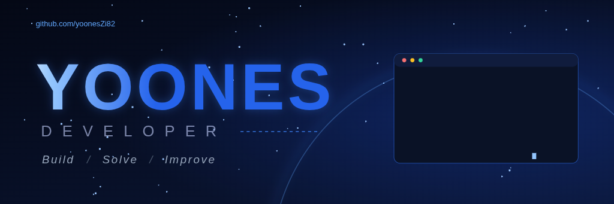
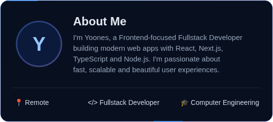
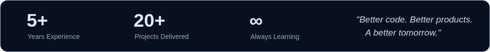

<table>
<tr>
<td width="46%" valign="top"></td>
<td width="54%" valign="top">

### 💻 Tech Stack

**Frontend** 
 

**Backend** 
 

**Database** 
 

**Tools** 
 

</td>
</tr>
</table>

<table>
<tr>
<td align="center" width="20%"><b>🖥️ Web Applications</b> Scalable, high-performance apps with React, Next.js and Node.js</td>
<td align="center" width="20%"><b>⚡ Real-time Systems</b> WebSockets, live data and real-time communication</td>
<td align="center" width="20%"><b>🍽️ Restaurant Management</b> Panels, monitoring, VoIP and large monorepos</td>
<td align="center" width="20%"><b>🌐 International Products</b> Multi-tenant systems, roles/permissions, payments</td>
<td align="center" width="20%"><b>🤝 Freelance & Remote</b> Working remotely with great teams worldwide</td>
</tr>
</table>

