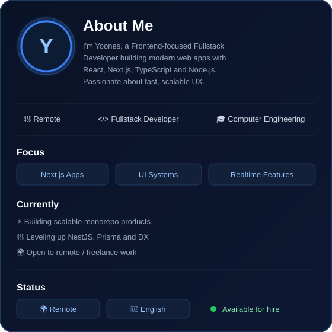
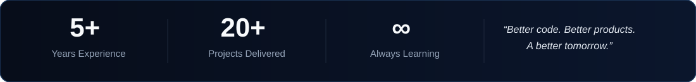

  

 

<table>
<tr>
<td width="46%" valign="top">

 

**📌 Quick links**

[Portfolio](https://yoones-web.ir) · [Email](mailto:yoones.dev@gmail.com) · [Discord](https://discord.gg/yooneszi82) · [Instagram](https://instagram.com/yoones_zamani_)

**🧠 What I enjoy**
- Clean UI systems & design systems
- Realtime apps (Socket.io / live data)
- Monorepos with Nx & Turborepo
- Shipping products end-to-end

**🎯 Looking for**
- Remote / freelance frontend & fullstack roles
- Product teams building serious web apps

</td>
<td width="54%" valign="top">

### 💻 Tech Stack

**Frontend**

**Backend**

**Database**

**Tools**

</td>
</tr>
</table>

<table>
<tr>
<td align="center" width="20%"><b>🖥️ Web Applications</b> Scalable apps with React, Next.js & Node.js</td>
<td align="center" width="20%"><b>⚡ Real-time Systems</b> WebSockets, live data & realtime UX</td>
<td align="center" width="20%"><b>🍽️ Restaurant Management</b> Panels, monitoring, VoIP & monorepos</td>
<td align="center" width="20%"><b>🌐 International Products</b> Multi-tenant, roles & payments</td>
<td align="center" width="20%"><b>🤝 Freelance & Remote</b> Remote work with teams worldwide</td>
</tr>
</table>

 

 

<table align="center">
  <tr>
    <td align="center" valign="top">
      
    </td>
    <td align="center" valign="top">
      
    </td>
  </tr>
  <tr>
    <td colspan="2" align="center">
      
    </td>
  </tr>
</table>

 

